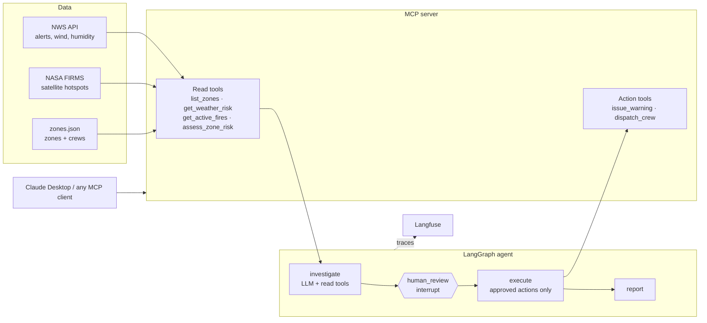

# Wildfire Ops Agent

A human-in-the-loop AI agent that helps a county emergency manager decide **which zones to alert and where to send crews** during fire season, using live weather and satellite fire data.

> Status: v0.1 (day 1 scaffold). Eval results and user feedback coming.

## Why
During a fire, emergency managers have to combine scattered sources (NWS alerts, satellite hotspots, local knowledge) under time pressure. This agent gathers and scores the data, **proposes** actions with evidence, and **waits for a human to approve** before anything happens.

## Architecture



**Design choices**
- **The LLM never does the math.** Risk scores are deterministic and explainable (`risk.py`); the LLM reads them, reasons about context, and writes the proposal.
- **Weather alone can't trigger an evacuation.** It caps at "advisory"; evacuations require a detected fire.
- **Read vs. act separation.** The investigator only gets read tools. Action tools run only after approval.
- **Scenario replay.** Any run can replay recorded conditions (`WILDFIRE_SCENARIO`), which makes evals reproducible.

## Quickstart

```bash
python -m venv .venv && source .venv/bin/activate
pip install -e ".[dev]"
cp .env.example .env          # add ANTHROPIC_API_KEY (+ FIRMS_MAP_KEY for live fires)

pytest -q                     # offline tests, no keys needed

# Live data
python -m wildfire_ops.run

# Replay a scenario
WILDFIRE_SCENARIO=data/scenarios/oakland_hills_fire.json python -m wildfire_ops.run

# Evals
python evals/run_evals.py
```

### Use it from Claude Desktop
Add to `claude_desktop_config.json`:
```json
{
  "mcpServers": {
    "wildfire-ops": {
      "command": "/ABSOLUTE/PATH/wildfire-ops-agent/.venv/bin/python",
      "args": ["-m", "wildfire_ops.mcp_server"],
      "env": { "FIRMS_MAP_KEY": "your-key" }
    }
  }
}
```

## Evals
| Metric | Meaning |
|---|---|
| level_accuracy | Zones where the agent's alert level matches the expected level |
| missed_critical | Zones that needed an evacuation warning or order but got less (the key metric) |
| false_alarms | Zones alerted when they shouldn't have been |
| crew_ok | A crew was sent to every zone that needed one |

Results: _TODO_

## Roadmap
- [ ] Historical fire scenarios with real outcomes
- [ ] Langfuse datasets + LLM-as-judge on alert message quality
- [ ] Feedback from an emergency-management practitioner
- [ ] FastAPI endpoint
